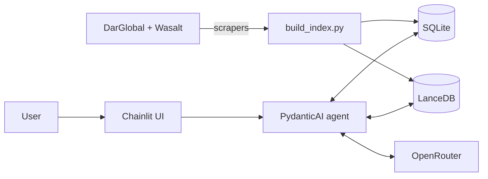

# Maskan: AI Property Concierge

**Live demo: https://darglobal-agent.allwinnoble.com**

An AI chatbot that answers questions about **DarGlobal's 38 projects** and **Wasalt listings in Riyadh and Jeddah**, in English or Arabic.

> Independent demo built from publicly available data. Not affiliated with DarGlobal or Wasalt.

## Assignment checklist

| Requirement | Delivered |
| --- | --- |
| Scrape DarGlobal and Wasalt | 38 DarGlobal projects; 957 Wasalt listings + 16 projects ([scraping report](docs/scraping-report.md)) |
| Build an AI chatbot on the data | Agent with tools over a SQL database and a hybrid search index |
| Free model via OpenRouter | `openrouter/free` (configurable fallback list) |
| Containerise with Docker | [Dockerfile](Dockerfile), [docker-compose.yml](docker-compose.yml) |
| Deploy | VPS with Docker Compose and Traefik (HTTPS) |
| Working URL | https://darglobal-agent.allwinnoble.com |

## How it works



- **Scraping:** both sites embed their data as JSON in each page (`__NEXT_DATA__`), so the scrapers read it directly.
- **Two stores:** SQLite for exact filters (price, bedrooms, district); LanceDB for hybrid semantic and keyword search over descriptions.
- **Agent:** picks its own tools (listing search, market stats, project search, knowledge search, calculators) and cites every source.
- **UI:** Chainlit, with each tool call visible as a step.

## Try asking

- *4-bedroom villas in Riyadh under 3 million SAR*
- *Which Jeddah districts are cheapest per sqm for apartments?*
- *Tell me about DarGlobal's DG1*
- *Compare Trump Tower Jeddah with apartments for sale in Jeddah*
- *ما هي أرخص الفلل في جدة؟*

## Run locally

```bash
python3.12 -m venv .venv && source .venv/bin/activate
pip install -r requirements.txt
cp .env.example .env    # add OPENROUTER_API_KEY
mkdir -p .chainlit/translations
cp chainlit_config.toml .chainlit/config.toml && cp translations/en-US.json .chainlit/translations/
chainlit run app.py
```

## Deploy

```bash
cp .env.example .env    # set OPENROUTER_API_KEY and APP_DOMAIN
docker compose up -d --build
```

Requires a Traefik network named `root_default` and a DNS record for `APP_DOMAIN`.

## Project structure

```
app.py            Chat UI
agent.py          Agent and tools
tools.py          Database queries, hybrid search, calculators
embeddings.py     Embedding model
build_index.py    Builds SQLite + LanceDB from scraped data
scrapers/         DarGlobal and Wasalt scrapers
data/             Built database and index
public/           Branding (logo, theme)
```

## Stack

Python · httpx · Playwright · SQLite · LanceDB · fastembed · PydanticAI · OpenRouter · Chainlit · Docker · Traefik

## Limitations

- Free models vary in quality and are rate-limited.
- Wasalt data is a sample (villas and apartments for sale, Riyadh and Jeddah).
- DarGlobal rarely publishes prices, so the agent says "price on request".
- Data is a snapshot from November 2026.
