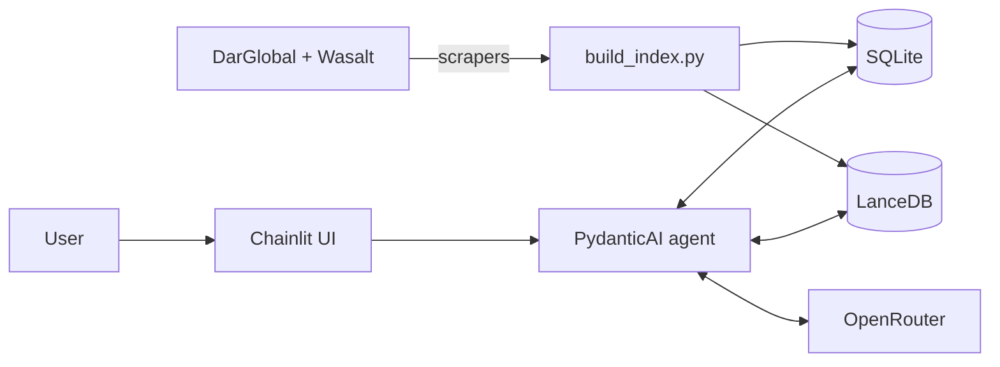

# Maskan: AI Property Concierge

**Live demo: https://darglobal-agent.allwinnoble.com**

An AI chatbot that answers questions about **DarGlobal's 38 projects** and **Wasalt listings in Riyadh and Jeddah**, in English or Arabic.

> Independent demo built from publicly available data. Not affiliated with DarGlobal or Wasalt.

## Assignment checklist

| Requirement | Delivered |
| --- | --- |
| Scrape DarGlobal and Wasalt | 38 DarGlobal projects; 957 Wasalt listings + 16 projects ([scraping report](docs/scraping-report.md)) |
| Build an AI chatbot on the data | Agent with tools over a SQL database and a hybrid search index |
| Free model via OpenRouter | `openrouter/free` (configurable fallback list) |
| Containerise with Docker | [Dockerfile](Dockerfile), [docker-compose.yml](docker-compose.yml) |
| Deploy | VPS with Docker Compose and Traefik (HTTPS) |
| Working URL | https://darglobal-agent.allwinnoble.com |

## How it works



- **Scraping:** both sites embed their data as JSON in each page (`__NEXT_DATA__`), so the scrapers read it directly.
- **Two stores:** SQLite for exact filters (price, bedrooms, district); LanceDB for hybrid semantic and keyword search over descriptions.
- **Agent:** picks its own tools (listing search, market stats, project search, knowledge search, contact info, calculators) and cites every source.
- **UI:** Chainlit, with each tool call visible as a step (see the Features section below).

## Features

| Feature | What you see |
| --- | --- |
| **Agentic tool use** | The agent chooses its own tools per question, and combines several sources for comparisons |
| **Query transparency** | Each tool call is an expandable step showing the data source, the exact query and the raw result |
| **Property cards** | Listings and DarGlobal projects appear as cards under the answer: photo, price, type, district, bedrooms, area, price per m², and a link to the source page |
| **Map view** | A **Map** tab plots the Wasalt listings with numbered pins that match the cards; click a pin for price and link |
| **Follow-up questions** | Three clickable follow-up questions after every answer (for example a narrower filter, the other city, or a mortgage on a result); clicking one continues the conversation |
| **Contact routes** | DarGlobal's official phone, WhatsApp and office; for Wasalt, a link to the listing (private sellers' numbers are never shared) |
| **English and Arabic** | Ask in either language; the answer comes back in the same one |
| **Conversation memory** | Follow-ups like "the cheapest one" or "same in Jeddah" refer back to earlier answers in the session |
| **Starter questions** | Six one-click examples on the home screen, each using several tools |

**How they're built**
- **Cards and map:** the listing tools pass each result's photo URL and coordinates to the UI but leave them out of what the model sees, so they cost no input tokens. The map uses Leaflet, bundled in `public/vendor/` (no CDN), with OpenStreetMap tiles. The cards are a custom Chainlit element (`public/elements/PropertyResults.jsx`).
- **Follow-ups:** the agent writes three suggestions at the end of the same reply, after a hidden marker, so there's no extra model call. The app strips them from the text and shows them as buttons. If a model leaves them out, the app falls back to suggestions based on the tools used.

## Business value

| Use case | Value | Who benefits |
| --- | --- | --- |
| **24/7 bilingual pre-sales concierge** | Instant answers about 38 projects in 6 countries, in English or Arabic, at any hour and in any time zone | International buyers; the sales team spends less time on repetitive questions |
| **Lead qualification and handoff** | The conversation already captures what a buyer wants (city, budget, bedrooms, project), then routes them to the official phone, WhatsApp or the project's register-interest page | Sales: warmer, better-qualified leads |
| **Cross-selling across the group** | A buyer comparing resale homes on Wasalt can be shown DarGlobal's off-plan projects in the same city, and the reverse | DarGlobal and Wasalt |
| **Market intelligence** | Price per m² by district, comparable listings and price ranges, available on request | Sales and pricing teams, marketing, investors |
| **Decision support** | Mortgage estimates and Gulf currency conversion inside the conversation | Buyers, especially those buying from abroad |
| **Trust and compliance** | Every answer is cited, prices are never invented ("price on request"), and personal data is never shared (PDPL) | Brand reputation, legal and compliance |

**How it could be measured:** share of questions answered without a person; response time; leads per conversation and lead-to-viewing conversion; and the most-asked cities, budgets and projects, which also act as a live demand signal for marketing.

**What would come next for production:** capturing leads directly into the CRM (with the user's consent and a confirmation step), scheduled re-scraping or direct feeds from both platforms, conversation analytics, and the evaluation suite running in CI before every release.

## Data sources

The agent can query three data sources, built by `build_index.py`:

| # | Data source | Store | Contents | Queried by |
| --- | --- | --- | --- | --- |
| 1 | **DarGlobal projects** | SQLite: `darglobal_projects` | 38 projects: country, city, type, bedrooms, completion, status, link | `search_darglobal_projects` |
| 2 | **Wasalt listings** | SQLite: `wasalt_listings`, `wasalt_projects` | 957 listings + 16 projects: price, district, type, bedrooms, area, price per sqm, link | `search_wasalt_listings`, `wasalt_market_stats` |
| 3 | **Knowledge base** | LanceDB: `chunks` | Text from DarGlobal project pages and location guides, plus Wasalt listing summaries, searched by meaning and keywords | `search_knowledge` |

Calculators (`calculate`, `mortgage_payment`, `convert_gulf_currency`) don't read any data; they do the maths on results.

**Contact requests** go to `get_contact_info`. For DarGlobal it returns the company's published contacts (customer service phone, WhatsApp, head office), saved by the scraper to `data/darglobal_contact.json`. For Wasalt it points to the listing page: sellers' and brokers' phone numbers are personal data and are never stored or shared.

## See what the agent queried

Every tool call shows up as a step above the answer. Click a step to see:

- **the step name:** which tool, and therefore which data source, the agent chose;
- **Input:** the exact query the agent sent (its filters or search text);
- **Output:** the raw data that came back, which the answer is built from.

For example, *"Which Jeddah districts are cheapest per sqm for apartments?"* shows:

```
▸ wasalt_market_stats                      ← data source 2: Wasalt listings
  Input
  {
    "city": "Jeddah",
    "property_type": "Apartment",
    "group_by_district": true,
    "sort_districts_by": "price_per_sqm_asc"
  }
  Output
  {
    "currency": "SAR",
    "by_district": [
      {"district": "…", "listings": 9, "avg_price": …, "avg_price_per_sqm": …},
      …
    ]
  }
```

A comparison question such as *"Compare Trump Tower Jeddah with apartments for sale in Jeddah"* shows two steps, `search_knowledge` (knowledge base) and then `search_wasalt_listings` (Wasalt), so you can see the agent combine both sources. Every listing or project in the answer also links to its source page.

## Try asking

- *4-bedroom villas in Riyadh under 3 million SAR*
- *Which Jeddah districts are cheapest per sqm for apartments?*
- *Tell me about DarGlobal's DG1*
- *Compare Trump Tower Jeddah with apartments for sale in Jeddah*
- *ما هي أرخص الفلل في جدة؟*

## Evaluation

`evals.py` runs 18 test questions against the live agent and checks each answer automatically:

- **Tool selection:** did the agent call the right tool(s)?
- **Facts:** are the key numbers and names correct? Expected values are computed from the database at run time, so the tests stay valid after a re-scrape.
- **Citations:** are sources linked?
- **Guardrails:** does it decline out-of-scope and prompt-injection requests, reply in Arabic when asked in Arabic, avoid inventing DarGlobal prices, and never share a private seller's phone number?

```bash
python evals.py              # writes evals/results.md and evals/results.json
```

Latest results: [evals/results.md](evals/results.md)

## Run locally

```bash
python3.12 -m venv .venv && source .venv/bin/activate
pip install -r requirements.txt
cp .env.example .env    # add OPENROUTER_API_KEY
mkdir -p .chainlit/translations
cp chainlit_config.toml .chainlit/config.toml && cp translations/en-US.json .chainlit/translations/
chainlit run app.py
```

## Deploy

```bash
cp .env.example .env    # set OPENROUTER_API_KEY and APP_DOMAIN
docker compose up -d --build
```

Requires a Traefik network named `root_default` and a DNS record for `APP_DOMAIN`.

## Project structure

```
app.py            Chat UI
agent.py          Agent and tools
tools.py          Database queries, hybrid search, calculators
embeddings.py     Embedding model
build_index.py    Builds SQLite + LanceDB from scraped data
evals.py          Evaluation suite (18 cases)
scrapers/         DarGlobal and Wasalt scrapers
data/             Built database and index
public/           Branding, property cards + map component
```

## Stack

Python · httpx · Playwright · SQLite · LanceDB · fastembed · PydanticAI · OpenRouter · Chainlit · Docker · Traefik

## Limitations

- Free models vary in quality and are rate-limited.
- Wasalt data is a sample (villas and apartments for sale, Riyadh and Jeddah).
- DarGlobal rarely publishes prices, so the agent says "price on request".
- Data is a snapshot from November 2026.
